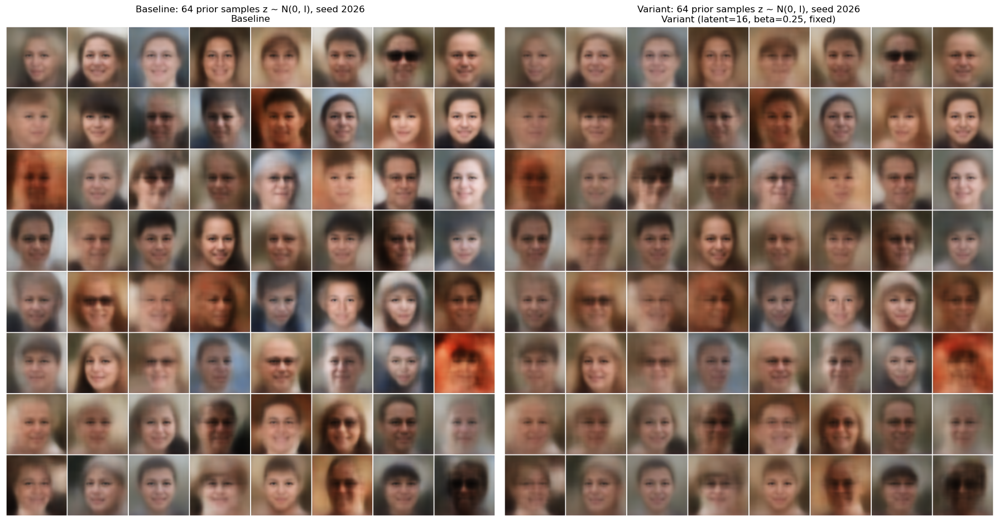
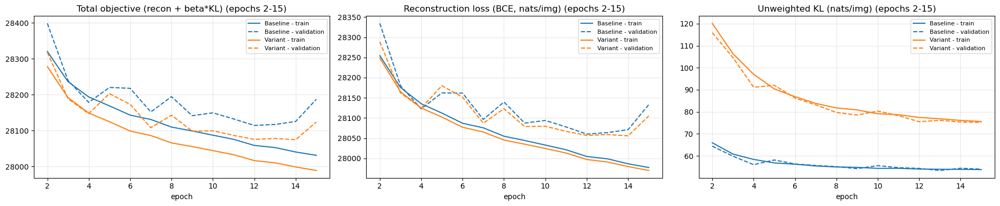

# FFHQ128 Variational Autoencoder

A convolutional variational autoencoder (VAE) trained on 128 x 128 face images from [FFHQ](https://github.com/NVlabs/ffhq-dataset), written from scratch in PyTorch. It runs a controlled experiment on one question: **what happens when the KL weight drops from β = 1.0 to β = 0.25, with everything else held fixed?**

Lowering β raised the KL by 39% but improved reconstruction by only 0.1%, with no visible change in the reconstructions. The prior samples got slightly worse, turning lower in contrast and more alike.

This was completed as Assignment 2 for ARTI5001. All code, executed outputs and the full written analysis are in [the notebook](a1988198_wimukthi_rajapaksha_A2-1.ipynb).

## Results

Test-set values, as the mean over 5,000 images. Losses are in nats per image.

| Metric | Baseline (β = 1.0) | Variant (β = 0.25) | Change |
|---|---:|---:|---:|
| Reconstruction (BCE) | 28,066.21 | 28,039.44 | -0.10% |
| Unweighted KL | 54.24 | 75.63 | +39.44% |
| Negative ELBO at β = 1 (recon + KL) | 28,120.45 | 28,115.08 | -0.02% |
| Reconstruction above the BCE floor | 2,744.04 | 2,717.27 | -0.98% |
| Active latent units (of 16) | 16 | 16 | none |

BCE on continuous pixel values can't reach zero. Its floor is the BCE of a perfect reconstruction, 25,322.17 nats per image on this test set, so the "above the floor" row is the model's actual error.

**Predictions compared with the outcome** (predictions were written down before training):

| Prediction for β = 0.25 | Outcome |
|---|---|
| Lower reconstruction loss, visibly sharper images | Direction confirmed, but the gain is small and not visible |
| Higher KL, more active units | KL confirmed; both models already use all 16 units |
| Worse prior samples | Confirmed, but through averaging rather than the predicted distortion |
| Less smooth interpolations | Not supported; both paths are smooth |
| Similar or slightly worse negative ELBO | Confirmed as similar: the 5.4-nat difference is much smaller than the validation spikes (35-62 nats), so the models are treated as tied |

The extra information mostly spread the latent codes apart instead of capturing new detail. Details the baseline loses, such as clear-lens glasses and headwear, are still lost at β = 0.25. This suggests the limit is the 16-dimensional bottleneck, the decoder and the BCE likelihood rather than the KL weight.

These results come from a single seed per condition, so variation across seeds is untested. Sample quality was judged by eye, without a metric such as FID.

### Prior samples

Each grid position decodes the same `z ~ N(0, I)` in both models (seed 2026).



### Training and validation curves

Epochs 2-15. Epoch 1 is left out because it dominates the y-axis; the notebook has the full range.



Reconstructions and latent interpolations are in sections 5.2 and 5.4 of the notebook.

## Model and objective

| Part | Details |
|---|---|
| Encoder | 5 blocks of Conv 4x4 (stride 2), BatchNorm, LeakyReLU(0.2); channels 32, 64, 128, 256, 256; 128 x 128 down to 4 x 4 |
| Latent | Separate linear heads for `mu` and `logvar`, with `logvar` clamped to [-10, 10]; 16 dimensions |
| Decoder | Linear layer, then 5 blocks of nearest-neighbour upsample, Conv 3x3, BatchNorm, LeakyReLU(0.2); channels 256, 128, 64, 32, 32 |
| Output | Conv 3x3 to 3-channel logits, with a sigmoid applied only for visualisation |
| Parameters | 2,928,451 trainable |

The objective is `reconstruction + β * KL`, using `binary_cross_entropy_with_logits` and the analytic KL against `N(0, I)`. Both terms are summed within each image and averaged across images, so β = 1 is the true negative ELBO.

Only β differs between the two runs. They share these settings:

| Setting | Value |
|---|---|
| Seed | 5001, reset before each run |
| Data split | 30,000 train / 5,000 validation / 5,000 test |
| Optimiser | Adam, learning rate 1e-3, betas (0.9, 0.999) |
| Batch size | 64 |
| Epochs | 15 (7,035 steps per run) |
| Augmentation | None |

The notebook asserts that both runs saw the same first training batch and started from the same initial-weight checksum.

## Running the notebook

The images and the split manifest are not in this repository, so you need to supply both. The manifest, `ffhq128_split_manifest.csv`, was provided with the course. It has `image_id`, `filename` and `split` columns and selects the 40,000 images used here, so reproducing these exact splits requires that file.

1. Install the dependencies. The recorded run used PyTorch 2.5.1.

   ```bash
   pip install torch torchvision numpy pandas matplotlib pillow jupyter
   ```

2. Download the `thumbnails128x128` folder from the [official FFHQ release](https://github.com/NVlabs/ffhq-dataset).

3. Arrange the files next to the notebook:

   ```text
   .
   ├── a1988198_wimukthi_rajapaksha_A2-1.ipynb
   ├── ffhq128_split_manifest.csv
   └── thumbnails128x128/
       ├── 00000.png
       └── ...
   ```

4. Run all cells in order. The data-layout cell links the images into the `ffhq128/images/` structure the loader expects, without changing them, and it does nothing if that layout is already complete.

The recorded run used an Apple M4 GPU (MPS). GPU results aren't bit-for-bit deterministic across hardware, so a re-run elsewhere may give slightly different values.

## Repository contents

| Path | Contents |
|---|---|
| `a1988198_wimukthi_rajapaksha_A2-1.ipynb` | Code, executed outputs, written report, and the sources and AI-use declaration (section 7) |
| `assets/` | The two README figures, exported from the notebook outputs |

## Data licence

FFHQ is released by NVIDIA under CC BY-NC-SA 4.0, and the individual images are under the Flickr licences listed in the dataset's `LICENSE.txt`. It is used here for non-commercial educational purposes only. The notebook's saved outputs include sample FFHQ images.

## References

- Burda, Y., Grosse, R., & Salakhutdinov, R. (2016). Importance weighted autoencoders. *ICLR*.
- Karras, T., Laine, S., & Aila, T. (2019). A style-based generator architecture for generative adversarial networks. *CVPR*, 4401-4410.
- Kingma, D. P., & Welling, M. (2014). Auto-encoding variational Bayes. *ICLR*. arXiv:1312.6114.
- Rybkin, O., Daniilidis, K., & Levine, S. (2021). Simple and effective VAE training with calibrated decoders. *ICML*, PMLR 139.
